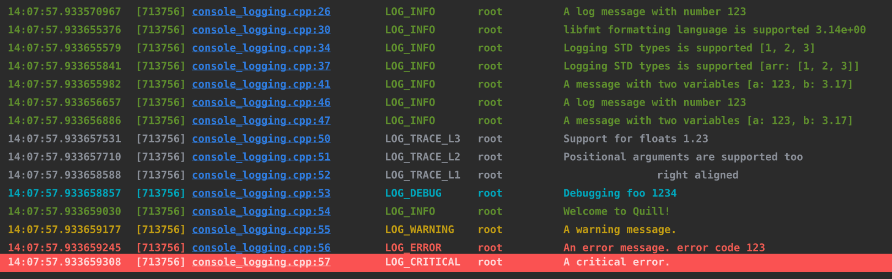
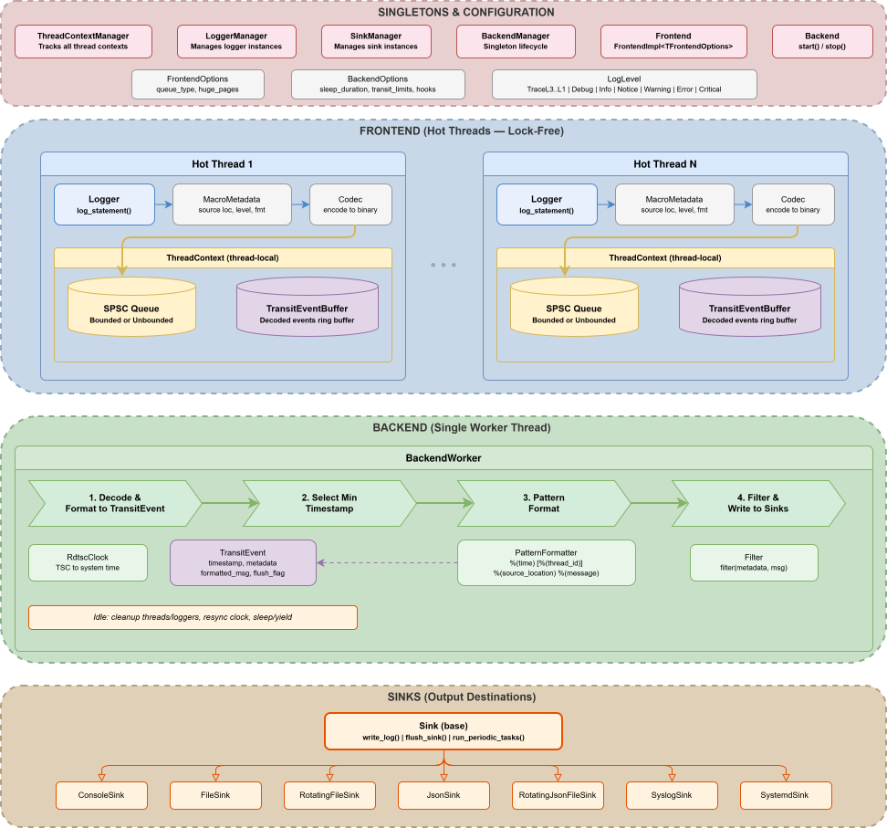

<div align="center">
  <!--
  <meta name="description" content="C++ logging library. High-performance, asynchronous logging for low-latency real-time applications.">
  <meta name="keywords" content="C++, logging library, asynchronous logging, high performance, low latency">
  -->

  <h1>
    <br>
    Quill
  </h1>
  <p><b>Ultra-Low-Latency Asynchronous C++17 Logging and Metrics Library</b></p>

  <div>
    <a href="https://github.com/odygrd/quill/actions?query=workflow%3Afedora">
      
    </a>
    <a href="https://github.com/odygrd/quill/actions?query=workflow%3Aubuntu">
      
    </a>
    <a href="https://github.com/odygrd/quill/actions?query=workflow%3Absd">
      
    </a>
    <a href="https://github.com/odygrd/quill/actions?query=workflow%3Amacos">
      
    </a>
    <a href="https://github.com/odygrd/quill/actions?query=workflow%3Awindows">
      
    </a>
    <a href="https://github.com/odygrd/quill/actions?query=workflow%3Aintelllvm">
      
    </a>
  </div>

  <div>
    <a href="https://codecov.io/gh/odygrd/quill">
      
    </a>
    <a href="https://github.com/odygrd/quill/actions/workflow/status/odygrd/quill/fuzz.yml">
      
    </a>
    <a href="https://app.codacy.com/gh/odygrd/quill/dashboard?utm_source=gh&utm_medium=referral&utm_content=&utm_campaign=Badge_grade">
      
    </a>
    <a href="https://www.codefactor.io/repository/github/odygrd/quill">
      
    </a>
  </div>

  <div>
    <a href="https://opensource.org/licenses/MIT">
      
    </a>
    <a href="https://en.wikipedia.org/wiki/C%2B%2B17">
      
    </a>
  </div>

  <h4>
    <a href="https://godbolt.org/z/n68asK7bY" title="Try Quill live on Compiler Explorer">🔬 Try It Online</a>
    <span> · </span>
    <a href="https://quillcpp.readthedocs.io/en/latest/benchmarks.html" title="Benchmark methodology and results">🚀 Benchmarks</a>
    <span> · </span>
    <a href="https://quillcpp.readthedocs.io" title="Explore the full documentation">📚 Documentation</a>
    <span> · </span>
    <a href="https://quillcpp.readthedocs.io/en/latest/recipes.html" title="Quick reference for common tasks">⚡ Recipes</a>
    <span> · </span>
    <a href="https://quillcpp.readthedocs.io/en/latest/faq.html" title="Frequently asked questions">❓ FAQ</a>
    <br />
    <a href="https://github.com/odygrd/quill/issues/new?assignees=&labels=&projects=&template=bug-report.md&title=" title="Report a bug or issue">🐛 Report Bug</a>
    <span> · </span>
    <a href="https://github.com/odygrd/quill/issues/new?assignees=&labels=&projects=&template=feature_request.md&title=">💡 Request Feature</a>
  </h4>

  <div align="center"></div>
</div>

---

## 🧭 Table of Contents

- [Introduction](#-introduction)
- [Use Cases](#-use-cases)
- [Quick Start](#-quick-start)
- [Features](#-features)
- [Performance](#-performance)
- [Usage](#-usage)
- [Design](#-design)
- [Caveats](#-caveats)
- [License](#-license)

---

## ✨ Introduction

**Quill** is an asynchronous logging and metrics library for **C++17 and later**. It keeps formatting and I/O away from
latency-sensitive application threads by encoding log arguments on the frontend and processing them on a dedicated
backend worker. A log call costs a few nanoseconds on the calling thread, the backend writes millions of messages per
second, and the code that logs stays quick to compile, so detailed logging can stay in your fastest code paths.

- **Low Frontend Latency**: Log arguments are encoded and queued for asynchronous processing, minimizing work on the
  calling thread. See the [latency benchmarks](https://quillcpp.readthedocs.io/en/latest/benchmarks_latency.html) for measured results and methodology.
- **Deferred Formatting**: Expensive formatting is performed by the backend worker instead of the calling thread.
- **High Backend Throughput**: A single backend thread formats and writes millions of messages per second to files,
  the console and custom sinks. See the [throughput benchmarks](https://quillcpp.readthedocs.io/en/latest/benchmarks_throughput.html).
- **Fast to Compile**: Files that log include only `Logger.h` and `LogMacros.h`, log statements with the same argument
  types share their code, and the backend is compiled in a single file of your own. See the
  [compilation time benchmark](https://quillcpp.readthedocs.io/en/latest/benchmarks_compile_time.html).
- **Logs, Metrics and Data Files**: The same asynchronous backend that writes your logs also publishes pre-registered
  [metrics](https://quillcpp.readthedocs.io/en/latest/metrics.html), through the bundled Prometheus sink or a sink of
  your own. It also writes [CSV files](https://quillcpp.readthedocs.io/en/latest/csv_writing.html), records
  [raw data](https://quillcpp.readthedocs.io/en/latest/binary_protocols.html#raw-binary-file-writing) such as a market
  data feed to files as it arrives, and writes
  [packet captures](https://quillcpp.readthedocs.io/en/latest/binary_protocols.html#writing-pcap-files) that Wireshark
  and tcpdump can open. See the [Use Cases](#-use-cases) for an example of each.
- **Highly Customizable**: Tune frontend queues and memory policy at compile time; configure backend idle behaviour,
  CPU affinity, buffering, timestamp handling, flushing, and callbacks at runtime; and compose loggers from built-in or
  custom sinks with per-sink filters. See
  [Frontend Options](https://quillcpp.readthedocs.io/en/latest/frontend_options.html),
  [Backend Options](https://quillcpp.readthedocs.io/en/latest/backend_options.html), and
  [Sinks](https://quillcpp.readthedocs.io/en/latest/sinks.html).
- **Production-Focused Testing**: Continuously tested across Linux, macOS, Windows, and BSD, with sanitizers and fuzzing.

> Using Quill? Click **Star** at the top of the [GitHub repository](https://github.com/odygrd/quill) to help other C++
> developers discover it.

---

## 🧰 Use Cases

**One backend thread for your logs, metrics, data files and packet captures.**

By default, every call below costs your thread one thing: encoding its arguments into a lock-free queue of its own,
which for most types is a plain copy. Formatting and I/O run later on the backend thread, which merges everything in
timestamp order across all threads. Where a record goes, to a file, a terminal or a metrics collector, does not change
what it costs your thread.

| Use Quill to                                                                                                                                                                 | Your thread calls                                               | The backend thread writes                                                                       |
|:-----------------------------------------------------------------------------------------------------------------------------------------------------------------------------|:----------------------------------------------------------------|:------------------------------------------------------------------------------------------------|
| Log [text](https://quillcpp.readthedocs.io/en/latest/sink_types.html) to the console, to files rotated by size or time, or to syslog, the systemd journal and Android logcat | `LOG_INFO(logger, "User {} logged in from {}", user, address);` | `User alice logged in from 10.0.0.5`, with the time, thread and source location of your pattern |
| Write structured [JSON](https://quillcpp.readthedocs.io/en/latest/json_logging.html) logs, for a log pipeline to search                                                      | `LOGJ_INFO(logger, "User logged in", user, address);`           | `{…,"user":"alice","address":"10.0.0.5"}`                                                       |
| Log [your own types](https://quillcpp.readthedocs.io/en/latest/recipes.html#logging-user-defined-types) with the formatter they already have                                 | `LOG_INFO(logger, "Connected to {}", endpoint);`                | `Connected to example.org:443`                                                                  |
| Publish [metrics](https://quillcpp.readthedocs.io/en/latest/metrics.html) to any metrics system, with a built-in sink for Prometheus                                         | `METRIC(metrics_logger, requests_total, 1.0);`                  | Each sample to your metrics sink, e.g. `requests_total 1024` for Prometheus                     |
| Write [CSV files](https://quillcpp.readthedocs.io/en/latest/csv_writing.html)                                                                                                | `weather_csv.append_row("Athens", 21.4, 40);`                   | `Athens,21.4,40`, below the header `city,temperature,humidity` of every file                    |
| Record [binary data](https://quillcpp.readthedocs.io/en/latest/binary_protocols.html#raw-binary-file-writing) as it arrives, such as a sensor stream or a market data feed   | `LOG_BINARY(logger, &reading, sizeof(reading));`                | The bytes as they are, or after their size and timestamp                                        |
| Capture [network traffic](https://quillcpp.readthedocs.io/en/latest/binary_protocols.html#writing-pcap-files)                                                                | `pcap_writer.write_packet(frame, frame_size, timestamp_ns);`    | A capture that Wireshark and tcpdump open, in a new file every hour if you like                 |
| Decode [binary protocols](https://quillcpp.readthedocs.io/en/latest/binary_protocols.html) such as SBE into readable text                                                    | `LOG_INFO(logger, "[IN] {}", SbeMessage{buffer, size});`        | The fields of each message, decoded on the backend thread                                       |
| Send records [anywhere](https://quillcpp.readthedocs.io/en/latest/sinks.html): a database, a socket, a message bus                                                           | A sink of your own, with `write_log(LogRecord const&)`          | Whatever your sink does with each record                                                        |

### Put Them Together

An application can have as many loggers and writers as it needs, for any mix of the above. They all share the one
backend thread, and a call still costs its thread only the encoding into its queue:

- 📈 **A trading system** logs its decisions as text, records the exchange feed to pcap files that rotate every hour,
  writes its fills to CSV, and publishes its order latencies as metrics.
- 🎮 **A multiplayer game server** keeps I/O out of its tick loop: it logs to rotating files, records each match as a
  binary replay, and publishes its tick time and the number of players online as metrics.
- 📞 **A VoIP server** logs to syslog, captures the packets of its calls to pcap files for Wireshark, and publishes the
  number of active calls as metrics.
- ☁️ **A service in a container** logs JSON to stdout for the platform to collect, and publishes its request counts as
  metrics.

---

## ⏩ Quick Start

Getting started is easy and straightforward. Follow these steps to integrate the library into your project:

### Installation

You can install Quill using the package manager of your choice:

| Package Manager |              Installation Command              |
|:---------------:|:----------------------------------------------:|
|      vcpkg      |             `vcpkg install quill`              |
|      Conan      |             `conan install quill`              |
|    Homebrew     |              `brew install quill`              |
|  Meson WrapDB   |           `meson wrap install quill`           |
|      Conda      |      `conda install -c conda-forge quill`      |
|     Bzlmod      | `bazel_dep(name = "quill", version = "x.y.z")` |
|      xmake      |             `xrepo install quill`              |
|       nix       |            `nix-shell -p quill-log`            |
|     build2      |                   `libquill`                   |

### Setup

#### Quickest Setup

For the shortest path from zero to working logs, use `simple_logger()`:

```c++
#include "quill/SimpleSetup.h"
#include "quill/LogMacros.h"

int main()
{
  // log to the console
  auto* logger = quill::simple_logger();
  LOG_INFO(logger, "Hello from {}!", "Quill");

  // log to a file
  auto* logger2 = quill::simple_logger("test.log");
  LOG_WARNING(logger2, "This message goes to a file");
}
```

**Console output:**

```
20:07:18.423476231 [48917] main.cpp:8                    LOG_INFO      Hello from Quill!
```

#### Detailed Setup

If you want explicit control over backend options, logger names, sinks, or formatters, use the
`Backend` and `Frontend` APIs directly:

```c++
#include "quill/Backend.h"
#include "quill/Frontend.h"
#include "quill/LogMacros.h"
#include "quill/Logger.h"
#include "quill/sinks/ConsoleSink.h"
#include <string_view>

int main()
{
  quill::Backend::start();

  quill::Logger* logger = quill::Frontend::create_or_get_logger(
    "root", quill::Frontend::create_or_get_sink<quill::ConsoleSink>("sink_id_1"));

  LOG_INFO(logger, "Hello from {}!", std::string_view{"Quill"});
}
```

**Output:**

```
20:07:18.423476231 [48917] main.cpp:15                   LOG_INFO      root         Hello from Quill!
```

You can also use the macro-free mode. The macro API (`LOG_INFO`) is the lowest-latency path.
The function API (`quill::info`) reads more like ordinary code but is slightly slower.
See [here](https://quillcpp.readthedocs.io/en/latest/macro_free_mode.html) for the trade-offs.

```c++
#include "quill/Backend.h"
#include "quill/Frontend.h"
#include "quill/LogFunctions.h"
#include "quill/Logger.h"
#include "quill/sinks/ConsoleSink.h"
#include <string_view>

int main()
{
  quill::Backend::start();

  quill::Logger* logger = quill::Frontend::create_or_get_logger(
    "root", quill::Frontend::create_or_get_sink<quill::ConsoleSink>("sink_id_1"));

  quill::info(logger, "Hello from {}!", std::string_view{"Quill"});
}
```

### Publishing Metrics

Register `MetricMetadata` once, then publish `double` samples from hot threads through the same asynchronous backend
used for logs. The bundled `PrometheusSink` handles counters, gauges, histograms, and summaries; custom sinks can route
samples to StatsD, OpenTelemetry, or any in-process collector via `Sink::write_metric()`.

```c++
// One-time registration — returns a stable pointer valid for program lifetime.
quill::MetricMetadata const* requests_total = quill::Frontend::create_metric(
  "requests_total_post_200", "requests_total", {{"method", "POST"}, {"status", "200"}});

// Hot path — no label serialization, just a pointer and a double.
logger->publish_metric(requests_total, 1.0);
```

See the [Metrics guide](https://quillcpp.readthedocs.io/en/latest/metrics.html) for sink setup, custom sinks, and
Prometheus integration.

---

## 🎯 Features

- **High-Performance**: Ultra-low latency performance.
- **Asynchronous Processing**: Background thread handles formatting and I/O, keeping your main thread responsive.
- **Metric Publishing**: Publish pre-registered metric samples to Prometheus, StatsD, OpenTelemetry, or any in-process
  collector through the same asynchronous backend.
  See [Metrics](https://quillcpp.readthedocs.io/en/latest/metrics.html).
- **Minimal Header Includes**:
  - **Frontend**: Only `Logger.h` and `LogMacros.h` needed for logging. Lightweight with minimal dependencies.
  - **Backend**: Single `.cpp` file inclusion. No backend code injection into other translation units.
- **Compile-Time Optimization**: Eliminate specific log levels at compile time.
- **Custom Formatters**: Define your own log output patterns.
  See [Formatters](https://quillcpp.readthedocs.io/en/latest/formatters.html).
- **Cross-Thread Timestamp Handling**: The backend compares available events across frontend queues by timestamp, with
  a configurable grace window for delayed producers and optional sink-visible monotonic timestamp correction.
  See [Timestamp Types](https://quillcpp.readthedocs.io/en/latest/timestamp_types.html).
- **Flexible Timestamps**: Support for `rdtsc`, `chrono`, or `custom clocks` - ideal for simulations and more.
  See the [custom clock examples](https://quillcpp.readthedocs.io/en/latest/timestamp_types.html)
  for runtime-polymorphic clocks or a concrete clock type that allows frontend inlining.
- **Backtrace Logging**: Store messages in a ring buffer for on-demand display.
  See [Backtrace Logging](https://quillcpp.readthedocs.io/en/latest/backtrace_logging.html)
- **Multiple Output Sinks**: Console (with color), files (with rotation), JSON, ability to create custom sinks and more.
- **Log Filtering**: Process only relevant messages.
  See [Filters](https://quillcpp.readthedocs.io/en/latest/filters.html).
- **JSON Logging**: Structured log output.
  See [JSON Logging](https://quillcpp.readthedocs.io/en/latest/json_logging.html)
- **Mapped Diagnostic Context (MDC)**: Thread-local key/value context attached automatically to subsequent log lines.
  See [MDC](https://quillcpp.readthedocs.io/en/latest/mdc.html).
- **Rate-Limited Macros**: `LOG_*_LIMIT` / `LOGV_*_LIMIT` emit at most once per configured interval per call site.
- **Configurable Queue Modes**: `bounded/unbounded` and `blocking/dropping` options with monitoring on dropped messages,
  queue reallocations, and blocked hot threads.
- **Crash Handling**: Built-in signal handler for log preservation during crashes.
- **Huge Pages Support (Linux)**: Leverage huge pages on the hot path for optimized performance.
- **Wide Character Support (Windows)**: Logs wide strings by converting them to UTF-8 on the backend, with support for
  STL containers consisting of wide strings.
- **Exception-Free Option**: Configurable builds with or without exception handling.
- **Clean Codebase**: Maintained to high standards, warning-free even at strict levels.
- **Type-Safe API**: Built on [{fmt}](https://github.com/fmtlib/fmt) library.

---

## 🚀 Performance

The results are on the [C++ logging library benchmarks](https://quillcpp.readthedocs.io/en/latest/benchmarks.html) page of the documentation. They
compare Quill with other C++ logging libraries on Linux (GCC) and Windows (MSVC): frontend latency when logging numbers,
large strings and complex types, backend throughput, and compile time.

You can find the benchmark code on the [logger_benchmarks](https://github.com/odygrd/logger_benchmarks) repository.

---

## 🧩 Usage

Also, see the [Quick Start Guide](https://quillcpp.readthedocs.io/en/latest/quick_start.html) for a brief introduction.

```c++
#include "quill/Backend.h"
#include "quill/Frontend.h"
#include "quill/LogMacros.h"
#include "quill/Logger.h"
#include "quill/sinks/ConsoleSink.h"
#include "quill/std/Array.h"

#include <string>
#include <utility>

int main()
{
  // Backend  
  quill::BackendOptions backend_options;
  quill::Backend::start(backend_options);

  // Frontend
  auto console_sink = quill::Frontend::create_or_get_sink<quill::ConsoleSink>("sink_id_1");
  quill::Logger* logger = quill::Frontend::create_or_get_logger("root", std::move(console_sink));

  // Change the LogLevel to print everything
  logger->set_log_level(quill::LogLevel::TraceL3);

  // A log message with number 123
  int a = 123;
  std::string l = "log";
  LOG_INFO(logger, "A {} message with number {}", l, a);

  // libfmt formatting language is supported 3.14e+00
  double pi = 3.141592653589793;
  LOG_INFO(logger, "libfmt formatting language is supported {:.2e}", pi);

  // Logging STD types is supported [1, 2, 3]
  std::array<int, 3> arr = {1, 2, 3};
  LOG_INFO(logger, "Logging STD types is supported {}", arr);

  // Logging STD types is supported [arr: [1, 2, 3]]
  LOGV_INFO(logger, "Logging STD types is supported", arr);

  // A message with two variables [a: 123, b: 3.17]
  double b = 3.17;
  LOGV_INFO(logger, "A message with two variables", a, b);

  for (uint32_t i = 0; i < 10; ++i)
  {
    // Will only log the message once per second
    LOG_INFO_LIMIT(std::chrono::seconds{1}, logger, "A {} message with number {}", l, a);
    LOGV_INFO_LIMIT(std::chrono::seconds{1}, logger, "A message with two variables", a, b);
  }

  LOG_TRACE_L3(logger, "Support for floats {:03.2f}", 1.23456);
  LOG_TRACE_L2(logger, "Positional arguments are {1} {0} ", "too", "supported");
  LOG_TRACE_L1(logger, "{:>30}", std::string_view {"right aligned"});
  LOG_DEBUG(logger, "Debugging foo {}", 1234);
  LOG_INFO(logger, "Welcome to Quill!");
  LOG_WARNING(logger, "A warning message.");
  LOG_ERROR(logger, "An error message. error code {}", 123);
  LOG_CRITICAL(logger, "A critical error.");
}
```

### Output



### External CMake

#### Building and Installing Quill

To get started with Quill, clone the repository and install it using CMake:

```bash
git clone https://github.com/odygrd/quill.git
cd quill
mkdir cmake_build
cd cmake_build
cmake ..
make install
```

- **Custom Installation**: Specify a custom directory with `-DCMAKE_INSTALL_PREFIX=/path/to/install/dir`.
- **Build Examples**: Include examples with `-DQUILL_BUILD_EXAMPLES=ON`.

Next, add Quill to your project using `find_package()`:

```cmake
find_package(quill REQUIRED)
target_link_libraries(your_target PUBLIC quill::quill)
```

#### Sample Directory Structure

Organize your project directory like this:

```
my_project/
├── CMakeLists.txt
├── main.cpp
```

#### Sample CMakeLists.txt

Here is a minimal `CMakeLists.txt`:

```cmake
# If Quill is in a non-standard directory, specify its path.
set(CMAKE_PREFIX_PATH /path/to/quill)

# Find and link the Quill library.
find_package(quill REQUIRED)
add_executable(example main.cpp)
target_link_libraries(example PUBLIC quill::quill)
```

### Embedded CMake

If you prefer to vendor Quill directly, add it as a subdirectory:

#### Sample Directory Structure

```
my_project/
├── quill/            # Quill repo folder
├── CMakeLists.txt
├── main.cpp
```

#### Sample CMakeLists.txt

Use this `CMakeLists.txt` to include Quill directly:

```cmake
cmake_minimum_required(VERSION 3.8)
project(my_project)

set(CMAKE_CXX_STANDARD 17)
set(CMAKE_CXX_STANDARD_REQUIRED ON)

add_subdirectory(quill)
add_executable(my_project main.cpp)
target_link_libraries(my_project PUBLIC quill::quill)
```

### Android NDK

Android usually works without special handling. If your toolchain does not support thread names,
configure with:

```bash
-DQUILL_NO_THREAD_NAME_SUPPORT:BOOL=ON
```

For timestamps, use `quill::ClockSource::system()`. Quill also includes an `AndroidSink` for
Android's logging system.

#### Minimal Example to Start Logging on Android

```c++
quill::Backend::start();

auto sink = quill::Frontend::create_or_get_sink<quill::AndroidSink>("app", [](){
    quill::AndroidSinkConfig asc;
    asc.set_tag("app");
    asc.set_format_message(true);
    return asc;
}());

auto logger = quill::Frontend::create_or_get_logger("root", std::move(sink),
                                                    quill::PatternFormatterOptions {}, 
                                                    quill::ClockSource::system());

LOG_INFO(logger, "Test {}", 123);
```

### Meson

#### Using WrapDB

Install Quill from Meson's `wrapdb` with:

```bash
meson wrap install quill
```

#### Manual Integration

Or copy the repository into `subprojects` and add the following to `meson.build`:

```meson
quill = subproject('quill')
quill_dep = quill.get_variable('quill_dep')
my_build_target = executable('name', 'main.cpp', dependencies : [quill_dep], install : true)
```

### Bazel

#### Using Bzlmod

Quill is available on `Bzlmod`.

#### Manual Integration

For manual setup, add Quill to your `BUILD.bazel` file like this:

```bazel
cc_binary(name = "app", srcs = ["main.cpp"], deps = ["//quill_path:quill"])
```

---

## 📐 Design

Quill is split into a **hot frontend** and a **cold backend**.

- Each frontend thread owns a lock-free SPSC queue. `LOG_*` macros binary-serialize arguments
  directly into that queue — no shared state, no contention between threads, no formatting work
  on the caller.
- A single backend worker drains all queues, merges events in timestamp order, invokes the
  per-argument-pack decode function to reconstruct arguments, runs `{fmt}` formatting and the
  `PatternFormatter`, and writes the resulting log lines or metric samples to the attached
  `Sink`s.

### Frontend (caller-thread)

When invoking a `LOG_` macro:

1. Creates a static constexpr metadata object containing the format string and source location.

2. Pushes the event into the SPSC lock-free queue. For each log message, Quill enqueues:

| Variable   |                                                  Description                                                   |
|------------|:--------------------------------------------------------------------------------------------------------------:|
| timestamp  |                                               Current timestamp                                                |
| Metadata*  |                                        Pointer to metadata information                                         |
| Logger*    |                                         Pointer to the logger instance                                         |
| DecodeFunc | A pointer to a templated function containing all the log message argument types, used for decoding the message |
| Args...    |           A serialized binary copy of each log message argument that was passed to the `LOG_` macro            |

When invoking `METRIC(...)` or `logger->publish_metric()`:

1. Reuses pre-registered `MetricMetadata`, so metric names and labels are not serialized again on the hot path.

2. Pushes a compact fixed-size sample record to the same SPSC queue.

| Variable        |                              Description                              |
|-----------------|:---------------------------------------------------------------------:|
| timestamp       |                           Current timestamp                           |
| MetricMetadata* |         Pointer to the pre-registered metric name and labels          |
| Logger*         |                    Pointer to the logger instance                     |
| value           | The actual sample value as a `double` (counter delta, latency, gauge) |

### Backend

The backend thread drains the SPSC queue, reconstructs log events, forwards metric samples to
`Sink::write_metric()`, and fans each log or metric event out to the sinks attached to the logger.

### Architecture Overview

The diagram below shows the end-to-end flow from hot frontend threads to the backend worker and sinks.



---

## 🚨 Caveats

**Do not log from destructors of static or global objects.** Quill's internal singletons are
function-local statics destroyed in reverse construction order. If a static object's constructor
triggers the first log call, the library singletons are constructed *after* that object and
destroyed *before* it. Logging from that destructor will then touch already-destroyed state.

**Use `fork()` with care.** Quill starts a background thread, and `fork()` interacts poorly with
multithreaded processes. If you need logging in child processes, call `quill::Backend::start()`
after `fork()` in each process that should log, and write parent and child output to different
files.

Example:

```c++
#include "quill/Backend.h"
#include "quill/Frontend.h"
#include "quill/LogMacros.h"
#include "quill/Logger.h"
#include "quill/sinks/FileSink.h"

int main()
{
  // DO NOT CALL THIS BEFORE FORK
  // quill::Backend::start();

  if (fork() == 0)
  {
    quill::Backend::start();

    // Write child output to its own file.
    auto file_sink = quill::Frontend::create_or_get_sink<quill::FileSink>("child.log");
    
    quill::Logger* logger = quill::Frontend::create_or_get_logger("root", std::move(file_sink));

    LOG_INFO(logger, "Hello from Child {}", 123);
  }
  else
  {
    quill::Backend::start();

    // Write parent output to its own file.
    auto file_sink = quill::Frontend::create_or_get_sink<quill::FileSink>("parent.log");

    quill::Logger* logger = quill::Frontend::create_or_get_logger("root", std::move(file_sink));

    LOG_INFO(logger, "Hello from Parent {}", 123);
  }
}
```

---

## 📝 License

Quill is licensed under the [MIT License](https://opensource.org/licenses/MIT).

Quill depends on third party libraries with separate copyright notices and license terms.
Your use of the source code for these subcomponents is subject to the terms and conditions of the following licenses.

- ([MIT License](https://opensource.org/licenses/MIT)) [{fmt}](https://github.com/fmtlib/fmt/blob/master/LICENSE)
- ([MIT License](https://opensource.org/licenses/MIT)) [doctest](https://github.com/onqtam/doctest/blob/master/LICENSE.txt)
