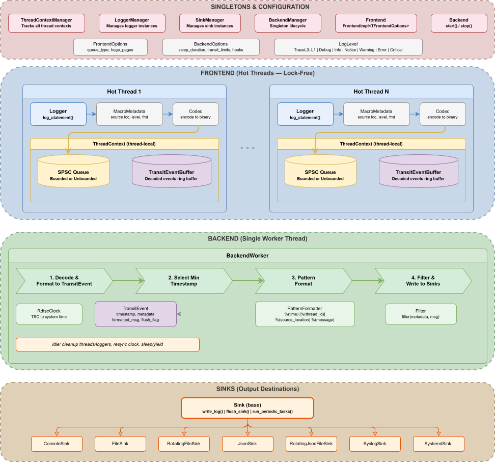

.. title:: Overview

.. _overview:

Overview
========

Quill is a C++17 asynchronous logging and metrics library for latency-sensitive code, including trading
systems, real-time engines, game servers and network stacks.

- **Frontend:** the calling thread only captures metadata and a binary copy of the log arguments, or a compact
  metric sample, into its own lock-free queue.
- **Backend:** one worker thread formats logs, forwards metric samples and does all the I/O, so even the slowest
  log line never blocks a hot thread on string conversion or disk writes.
- **Ordering:** the worker merges the events of all queues by timestamp, with a configurable grace period
  instead of per-call locking.
- **Sinks** handle logs, metrics or both. Files, consoles, rotation, JSON, syslog, systemd, Android and
  Prometheus are built in, and custom sinks implement a narrow virtual interface.

The diagram shows how a record travels from an application thread to its output.

Thread Safety
-------------

Threads can log through the same :cpp:type:`Logger` and change its active log level concurrently.

Logging types
-------------

Quill copies primitives, ``std::string`` and ``std::string_view`` for backend formatting. Include the matching
``quill/std`` header for a standard library type. For a user type, specialize ``Codec`` or, on a less
latency-sensitive path, convert it to a string before logging. See :doc:`recipes` for both examples.

Metrics
-------

Quill transports :doc:`metrics` to a collector through :cpp:func:`Sink::write_metric`. The bundled
``PrometheusSink`` handles Prometheus. Custom sinks can send to StatsD, OpenTelemetry or an in-process
collector. Collection and exposition belong to the chosen metrics backend.

Reliable Logging Mechanism
--------------------------

Each producer owns a lock-free single-producer, single-consumer (SPSC) queue. Producers do not contend for
the same queue. The default starts small and grows on the calling thread, which can add latency during a
burst. At ``FrontendOptions::unbounded_queue_max_capacity`` it blocks for space.
See :doc:`frontend_options` for queue modes, allocation limits and oversized records.

Manual Log Flushing
-------------------

:cpp:func:`LoggerImpl::flush_log` blocks the caller until the backend flushes entries up to the current
timestamp.

Synchronized Logs for Debugging
-------------------------------

For debugging, :cpp:func:`LoggerImpl::set_immediate_flush` makes the caller wait for the backend to write
after every message or every N messages. Frequent waits reduce throughput.

``FrontendOptions::enable_immediate_flush`` defaults to ``true`` for macros and functions. Set it to ``false``
to compile out the hot-path check. Explicit ``flush_log()`` still works. See :doc:`recipes` for an example.

Handling Application Crashes
----------------------------

The ``BackendWorker`` destructor drains pending messages on normal exit. A crash can lose queued records.
For best-effort crash reporting, pass :cpp:struct:`SignalHandlerOptions` to :cpp:func:`Backend::start`.

.. code-block:: cpp

   // With custom FrontendOptions, pass that type instead
   quill::Backend::start<quill::FrontendOptions>(quill::BackendOptions{}, quill::SignalHandlerOptions{});

**POSIX.** Before a thread can run the built-in handler, it must have logged once or called
:cpp:func:`FrontendImpl::preallocate`. Otherwise block the handled signals on that thread. Keep a custom
handler minimal. Use general logging or flush calls in signal context only if validated for that platform
and process state.

Configure the handler with these :cpp:struct:`SignalHandlerOptions` fields.

- ``catchable_signals`` defaults to ``SIGTERM``, ``SIGINT``, ``SIGABRT``, ``SIGFPE``, ``SIGILL``, ``SIGSEGV`` and, where
  available, ``SIGBUS``. After flushing, the handler re-raises the signal with its default disposition.
  ``Backend::stop()`` restores the previous signal handlers.
- ``timeout_seconds`` limits time in the POSIX handler. The default is 20 seconds. Zero disables the alarm.
- ``logger_name`` selects the crash logger. An empty name selects the first valid logger.
- ``excluded_logger_substrings`` skips matching names during automatic selection. The defaults,
  ``{"__csv__", "__binary__"}``, exclude CSV, binary and pcap writers. If none qualify, the handler still
  flushes the sinks without writing a crash message.

**Windows.** ``Backend::start()`` installs structured exception handling and a process-wide console control
handler. CRT signal handlers are thread-specific. Call ``quill::init_signal_handler<FrontendOptions>()`` on
each frontend thread needing CRT handling. Keep the backend worker free of CRT signal handlers.

Serialize application exception-filter installation with ``Backend::start()`` and ``Backend::stop()``. If the
application replaces Quill's filter while the backend runs, stopping and restarting preserves the replacement.
Quill's filter runs if the replacement forwards to it, then forwards to the filter that preceded Quill's.

Log Messages Timestamp Order
----------------------------

The worker compares available queue heads by timestamp. A configurable grace period lets delayed producers
publish earlier events. See :ref:`timestamp_types:timestamp recording` for ordering limits and corrections.

Number of Backend Threads
-------------------------

One worker handles all loggers in the process: Quill puts low caller latency before throughput, and multiple
backend threads are not supported. The worker's formatting and I/O rate bounds throughput. Coordinate
``Backend::start()`` and ``Backend::stop()`` across threads. Concurrent start and stop are unsupported.

Latency of the First Log Message
--------------------------------

The first log on each thread allocates its queue. Call :cpp:func:`FrontendImpl::preallocate` beforehand to move
this cost out of the first call. The worker polls every thread's queue. If an application starts thousands of
short-lived logging threads per second (one per request, for example), a thread pool avoids exceeding the
host's queue-processing rate.

Configuration
-------------

Select queue and memory policies at compile time with :cpp:class:`FrontendOptions`. Pass
:cpp:class:`BackendOptions` at startup for runtime worker settings.

Frontend (caller-thread)
------------------------

A :doc:`logger <loggers>` specifies a pattern and one or more :doc:`sinks`. A ``LOG_*`` macro takes the
logger, format string and arguments. Its static ``constexpr`` metadata holds the format string and source
location. Each call writes three kinds of data to the producer's queue.

- Timestamp, metadata pointer and logger pointer.
- ``DecodeFunc``, a pointer to the decoder for this pack of argument types.
- ``Args...``, a binary copy of the arguments.

``METRIC(...)`` and :cpp:func:`LoggerImpl::publish_metric` write a fixed-size record to the same queue.
It contains a timestamp, registered ``MetricMetadata*``, ``Logger*`` and a ``double`` value. Metric names and labels are
registered once.

Backend
-------

The worker decodes log arguments, formats the message with {fmt}, applies the logger's pattern and sends
it to each attached sink. It forwards metric samples to ``Sink::write_metric``.

See Also
--------

.. rst-class:: quill-link-list

- :doc:`Quick Start <quick_start>` for the shortest path to working logs.
- :doc:`Guides <guides>` for sinks, metrics, formatters, JSON, filters, and more.
- :doc:`Recipes <recipes>` for common tasks and code examples.
